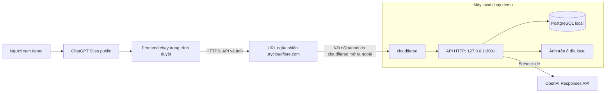

# seaPilot — Architecture

Cập nhật: **31/10/2026**. Phạm vi: kiến trúc đã chốt và kế hoạch đưa **API local** ra public bằng **Cloudflare Quick Tunnel** để FE trên **ChatGPT Sites public** gọi được.

Đây là tài liệu kiến trúc và vận hành demo. Tại thời điểm kiểm tra, checkout chưa có ứng dụng/API chạy được; các bước triển khai bên dưới áp dụng khi API đã sẵn sàng. Tài liệu không phân chia task xây dựng toàn bộ project.

## 1. Kiến trúc đã chốt



| Thành phần | Vị trí và trách nhiệm |
| --- | --- |
| Frontend | ChatGPT Sites, public để chia sẻ demo; trình duyệt gọi HTTPS API qua URL tunnel. |
| API | Chạy trên máy local; xử lý nghiệp vụ, xác thực, CORS, DB, ảnh và gọi OpenAI. Port `3001` là ví dụ, thay bằng port thực tế. |
| PostgreSQL | Chạy local; chỉ API truy cập. Không expose cổng DB qua tunnel. |
| Ảnh evidence | Lưu trên ổ đĩa local; trình duyệt đọc/upload qua endpoint API, không truy cập đường dẫn ổ đĩa. |
| cloudflared | Chuyển request từ URL HTTPS public về HTTP API local. API/DB vẫn chạy trên máy local. |

Các thay đổi so với tài liệu cũ: **Supabase → PostgreSQL + ảnh local; Vercel → API local qua Quick Tunnel và FE public trên ChatGPT Sites**. Những lựa chọn hosting cũ trong AGENTS/build prompts/prep pack chưa được viết lại trong phạm vi tài liệu này. Nghiệp vụ demo và nguyên tắc CS duyệt reply/action giữ nguyên.

**Quick Tunnel không cần login, tài khoản Cloudflare hay domain riêng.** Mỗi lần tạo tunnel có hostname ngẫu nhiên; user đã chấp nhận cập nhật URL cho demo. Không cần bước `cloudflared tunnel login`. [Cloudflare Quick Tunnels](https://developers.cloudflare.com/tunnel/get-started/quick-tunnels/)

## 2. Điều kiện trước khi triển khai

- PostgreSQL và API đã chạy local; API đọc/ghi được DB và thư mục ảnh có quyền ghi, dữ liệu còn sau restart.
- API có một endpoint GET an toàn để kiểm tra. Ví dụ dưới đây dùng `/api/health`; thay bằng endpoint thực tế nếu khác.
- API bind `127.0.0.1` khi cloudflared chạy cùng máy. Giữ máy bật, không sleep, có Internet trong suốt demo.
- FE có cấu hình API base URL. Toàn bộ request API/ảnh phải dùng base này, không gọi `localhost` của người xem hoặc `/api` trên origin của Sites.
- API key OpenAI, DB password và token quản trị chỉ nằm phía API local, ngoài Git/FE bundle. API public phải có kiểm soát truy cập riêng; public FE không đồng nghĩa public quyền reset dữ liệu hoặc gọi model không giới hạn.

## 3. Kế hoạch triển khai qua CLI

### Bước 1 — Chuẩn bị cloudflared một lần

Nếu đã có CLI trong PATH:

```powershell
cloudflared --version
```

Nếu chưa có, ví dụ tải binary **Windows x64** chính thức vào thư mục công cụ của user:

```powershell
$tunnelTools = Join-Path $env:LOCALAPPDATA 'cloudflared'
New-Item -ItemType Directory -Path $tunnelTools -Force | Out-Null
$tunnelExe = Join-Path $tunnelTools 'cloudflared.exe'
Invoke-WebRequest -Uri 'https://github.com/cloudflare/cloudflared/releases/latest/download/cloudflared-windows-amd64.exe' -OutFile $tunnelExe
& $tunnelExe --version
```

Chọn binary phù hợp nếu dùng hệ điều hành/kiến trúc khác. Lưu phiên bản dùng cho demo; Windows cần cập nhật cloudflared thủ công. [Cloudflare Downloads](https://developers.cloudflare.com/tunnel/downloads/)

### Bước 2 — Chạy và kiểm tra API local

Khởi động PostgreSQL, sau đó API bằng lệnh khởi động thực tế của ứng dụng. Checkout hiện chưa có package/scripts ứng dụng nên chưa thể chốt lệnh start. Giữ API chạy trong terminal riêng.

```powershell
$localApi = 'http://127.0.0.1:3001'
curl.exe -i "$localApi/api/health"
```

Chỉ mở tunnel khi endpoint trả kết quả đúng. Nếu endpoint cần auth, dùng thông tin truy cập của API; không bỏ auth để làm kiểm tra. Xác nhận API kết nối DB/ảnh, không chỉ kiểm tra port mở.

### Bước 3 — Mở Quick Tunnel

Trong terminal khác, chạy **một** cách phù hợp:

```powershell
# CLI đã nằm trong PATH:
cloudflared tunnel --url http://127.0.0.1:3001

# Hoặc binary vừa tải ở Bước 1:
# & "$env:LOCALAPPDATA\cloudflared\cloudflared.exe" tunnel --url http://127.0.0.1:3001
```

Giữ process chạy, lấy đúng URL `https://<hostname>.trycloudflare.com` được in trong log. Không cần cấu hình DNS hoặc mở port router. Dùng lệnh cơ bản trên; chưa thêm lớp đăng nhập email Cloudflare cho API vì luồng đó cần trình duyệt tương tác. [Hướng dẫn Quick Tunnel](https://developers.cloudflare.com/tunnel/get-started/quick-tunnels/)

### Bước 4 — Nối FE với API và cấu hình CORS

1. Đặt API base URL của FE bằng HTTPS URL vừa nhận, không thêm trùng `/api` nếu API client đã thêm prefix.
2. Publish FE **public** qua ChatGPT Sites. FE sử dụng bản build phù hợp với Sites; xử lý server/DB/OpenAI nằm ở API local. Các chức năng đang phụ thuộc Server Actions cùng origin cần được đánh giá trước khi deploy FE.
3. Lấy **Origin thực tế của request từ FE** trong DevTools Network. Origin gồm scheme + hostname + port, không gồm path và không có dấu `/` cuối. Không mặc định đó là `https://chatgpt.com` hoặc URL trang quản lý Site.
4. Thêm origin chính xác đó vào allowlist CORS của API rồi reload cấu hình/restart API theo cách ứng dụng hỗ trợ. Nếu cần local FE hoặc preview, thêm từng origin thực sự sử dụng.
5. Nếu API dùng token demo, nhập/cấp token lúc chạy demo; không nhúng token quản trị/OpenAI vào FE bundle. Không đưa token vào URL.

Tên biến cấu hình API base/CORS phụ thuộc ứng dụng hiện có; tài liệu không giả định biến hoặc script chưa được triển khai.

### Bước 5 — Kiểm tra đường public

Thay hai placeholder bằng giá trị thực. `$checkPath` phải là endpoint thực tế; nếu kiểm tra preflight POST, chọn route có hỗ trợ POST.

```powershell
$publicApi = 'https://REPLACE-WITH-TUNNEL.trycloudflare.com'
$siteOrigin = 'https://REPLACE-WITH-ACTUAL-FE-HOST'
$checkPath = '/api/health'
curl.exe -i "$publicApi$checkPath"
curl.exe -i -X OPTIONS "$publicApi$checkPath" -H "Origin: $siteOrigin" -H 'Access-Control-Request-Method: GET' -H 'Access-Control-Request-Headers: authorization'
```

Sau đó mở Site bằng trình duyệt khác/thiết bị khác: kiểm tra GET dữ liệu, một POST demo, upload và tải ảnh, và lỗi thiếu/sai token. `curl` thành công chưa chứng minh CORS hoặc chính sách trình duyệt của Sites đã cho phép kết nối.

## 4. Quy tắc CORS cần có trên API

| Mục | Cấu hình yêu cầu |
| --- | --- |
| Origin | So khớp allowlist chính xác; trả `Access-Control-Allow-Origin` bằng origin được phép, kèm `Vary: Origin`. Không dùng `*` hoặc phản chiếu mọi Origin. |
| Preflight | Xử lý `OPTIONS` trước kiểm tra auth/body nghiệp vụ; trả `204` cho yêu cầu hợp lệ mà không yêu cầu token. |
| Methods | Chỉ cho các method endpoint thực dùng, ví dụ `GET, POST, OPTIONS`. |
| Headers | Cho `Authorization`, `Content-Type` khi sử dụng; chỉ thêm header khác nếu API client thực sự gửi. |
| Response | Có CORS header trên response thành công và lỗi do ứng dụng trả về cho origin được phép, gồm `401`, `400`, `500`. |
| Credentials | Với Bearer demo token: FE dùng `credentials: 'omit'`, không bật cookie cross-site hoặc `Access-Control-Allow-Credentials`. Nếu API đang dùng cookie, phải rà lại riêng trước khi deploy. |

CORS là cơ chế của trình duyệt, không thay thế xác thực/phân quyền API. Không dùng `mode: 'no-cors'` để chữa lỗi vì FE sẽ không đọc được response. [MDN CORS](https://developer.mozilla.org/en-US/docs/Web/HTTP/Guides/CORS)

Với ảnh: lưu khóa file/ID hoặc đường dẫn API tương đối, không lưu hostname tunnel hay đường dẫn ổ đĩa trong URL gửi FE. Nếu endpoint ảnh cần Bearer header, FE fetch ảnh có auth rồi hiển thị blob; `` không tự gửi custom Bearer header.

## 5. Vận hành sau khi mở tunnel

- **Tạo lại tunnel:** lấy URL mới → cập nhật API base của FE → publish lại nếu URL nằm trong build, hoặc cập nhật runtime config nếu ứng dụng đã hỗ trợ → kiểm tra lại API và ảnh. Không cần đổi CORS nếu origin FE không đổi; nếu origin FE đổi thì cập nhật allowlist.
- **Dừng demo:** `Ctrl+C` ở terminal cloudflared để đóng đường public. Dừng API/DB riêng khi cần; thao tác này không yêu cầu reset hoặc xóa dữ liệu.
- **Giới hạn demo:** không cam kết uptime, tối đa 200 request đang xử lý đồng thời, không hỗ trợ SSE. API AI dùng response hoàn chỉnh hoặc cơ chế polling đã có; cần xem lại nếu API hiện chỉ stream SSE. [Giới hạn Quick Tunnel](https://developers.cloudflare.com/tunnel/get-started/quick-tunnels/)

| Hiện tượng | Kiểm tra trước |
| --- | --- |
| `502` / không tới API | API local còn chạy, port/URL đúng, cloudflared truy cập được cùng host. |
| `curl` được nhưng FE lỗi | Origin/preflight/headers, HTTPS API base, CSP `connect-src` của trang đang chạy. Nếu CSP chặn tunnel thì cần xác minh khả năng cấu hình Sites, không thể sửa chỉ bằng CORS backend. |
| Lỗi mạng sau restart | FE có đang giữ URL tunnel cũ không; process tunnel mới có kết nối chưa. |
| Ảnh hỏng | URL ảnh có dùng API base mới không; file còn trên disk; endpoint có yêu cầu auth không. |

Hoàn tất deployment khi Site public trên thiết bị khác gọi được API, đọc/ghi dữ liệu demo và ảnh; request sai quyền bị từ chối; sau khi tạo lại tunnel và cập nhật URL, dữ liệu/ảnh cũ vẫn dùng được. **Chưa thực hiện deploy hoặc xác minh CORS/CSP thực tế trong task tài liệu này.** Port, lệnh start API, endpoint kiểm tra và origin Site sẽ được điền khi có ứng dụng chạy.
