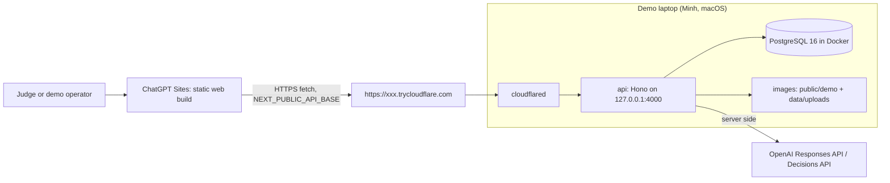
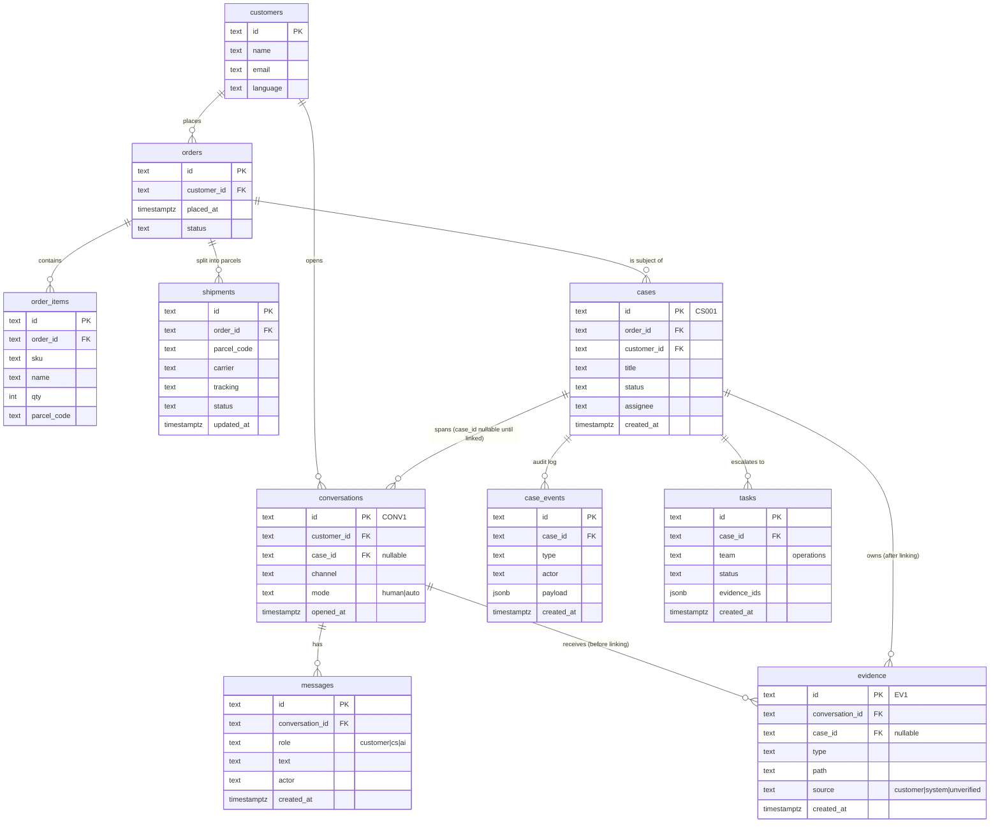

# seaPilot - Architecture

Current topology: two independent Next.js/shadcn apps on ports 3000/3001 and
`apps/api` (Hono on Node 20) on port 4000. PostgreSQL 16 runs in Docker behind
Drizzle and the CaseStore interface. `NEXT_PUBLIC_API_BASE` is the API connection
setting for both web apps; both web apps now call the API by default, with explicit fixture mode available.
See [API-BASE.md](API-BASE.md) and [API setup](../apps/api/README.md) for the merged runtime, environment and migration boundaries.

## Topology

| Part | Where | Responsibility |
|---|---|---|
| web | Two private ChatGPT Sites | `apps/customer` (3000), `apps/customer-service` (3001). API calls use `NEXT_PUBLIC_API_BASE`. |
| api | Minh's Mac, port 4000 | Routes, Zod validation, CaseStore, agent loop, triage, approvals, CORS, files. |
| Postgres | Docker on the Mac, port 5432 | All demo data, Drizzle migrations. Reset = truncate + seed. Never exposed. |
| cloudflared | Minh's Mac | Quick tunnel, random hostname, no account. Restart = new URL. |
| OpenAI | cloud | Only outbound network call during the demo. |

## Why this shape
- The judged logic (link case, what changed, one question, approve-then-act) lives in
  `apps/api/src/ai` and `apps/api/src/store`. The PostgreSQL adapter implements `CaseStore`; agent logic uses that interface.
- Postgres in Docker: the demo laptop already runs Docker, so one `docker compose up`
  gives a real schema with migrations and no local install. Storage stays behind
  `CaseStore`, so the demo could run on another adapter if Docker fails.
- Static Next.js exports run on separate Sites. The API serves data and demo
  files only; frontend hosting and its sign-in gate are independent.

## Historical integration gates (not T01b/T02 acceptance)
- Historical 13:30 Sites gate: verify health through the tunnel from a phone.
  The current API does not host either frontend; a tunnel URL alone is not a UI fallback.
- 14:30 Scene 2 runs end to end on Minh's Mac. WIP submission uses the tunnel URL.

## Future integrated request flow
1. Customer sends a message on `/customer` -> `POST /api/conversations/:id/messages`.
2. API runs triage (T07b, after Scene 2) -> `decideMode` -> human: `routeHuman`, set
   assignee, event `routed`; ai: run agent read-only, send reply, event `auto_reply`.
3. CS opens `/cs`, clicks Suggest -> `POST /api/agent/suggest` -> agent loop with
   tools `find_cases`, `get_case_context`, `get_order_shipments` -> `AgentSuggestion`.
4. CS approves -> `POST /api/cases/:id/approve` -> API writes message / task + events.
   UI shows "Sent" or "Escalated" only after `ok: true`.

## Env
- .env: `OPENAI_API_KEY`, `OPENAI_MODEL`, `DEMO_RESET_TOKEN`, `CORS_ORIGINS`, `DATABASE_URL`,
  `POSTGRES_PASSWORD`,
  later `TRIAGE_PROVIDER`, `DECISIONS_MODEL`.
- Each web app: `NEXT_PUBLIC_API_BASE` (build-time for static exports).

## CORS and files
Exact-origin allowlist, `Vary: Origin`, OPTIONS answered before auth, CORS headers on
error responses too. `GET /files/*` is public (demo images are not sensitive).
The web app stores file paths relative to the API, never the tunnel hostname.

## Operating the tunnel
- Start: `docker compose up -d db && pnpm db:migrate && pnpm db:reset && pnpm dev:api`, then
  `pnpm tunnel`. Copy the printed URL.
- New URL after restart: set `NEXT_PUBLIC_API_BASE`, rebuild web, republish Sites.
  `CORS_ORIGINS` changes only if the Sites origin changes.
- Limits: no uptime promise, no SSE. The agent endpoint returns a complete response.
- Keep the Mac awake, plugged in, notifications off. Phone hotspot as backup.

## Data model (ERD)

Event types: case_created, evidence_added, conversation_linked, assignee_changed,
shipment_updated, routed, ai_suggestion, auto_reply, reply_sent (payload carries
`shipment_snapshot`), action_executed, action_failed.

### Why this shape
- `cases` is the hub. A conversation points to a case, never the other way round, so a
  customer can open any number of conversations and they all land on one case.
- `conversations.case_id` is nullable: the new conversation exists before a human
  confirms the link (Scene 2 banner). Evidence attaches to the conversation first and
  moves to the case on link, so a photo is never lost and never duplicated.
- `case_events` is an append-only audit log. Approvals, routing, AI suggestions and
  action results all land here. It is what the timeline shows and what judges can audit.
- `reply_sent.payload.shipment_snapshot` is the baseline for "what changed": compare the
  parcels as they were when CS last answered with `shipments` now. No history table.
- `shipments` is per parcel, not per order, because the whole story is "parcel A arrived,
  parcel B did not": the missing-item case lives at parcel level.
- `tasks` is the hand-off to operations. The reply for Scene 3 is allowed only after this
  row exists.
- Text ids equal to fixture codes (CS001, CONV1, EV1) so prompts, tests and the UI speak
  the same names.

### Where the agent's memory comes from
The agent is stateless. Its memory is the case, read through three tools on every call:
1. `find_cases` - which case this customer and order already have (customers, orders, cases).
2. `get_case_context` - everything on that case: earlier conversations and messages,
   evidence with sources, the event timeline, open tasks, and `changes_since_last_contact`
   computed from the last `reply_sent` snapshot vs `shipments`.
3. `get_order_shipments` - the facts right now, parcel by parcel.
The model writes nothing back; the API records `ai_suggestion` and the human's decisions
as events. Chat memory dies with the conversation; case memory does not. That is the product.

### The three tables that make a case survive a shift change
- `evidence` is what the customer gave. It has both `conversation_id` and a nullable
  `case_id`: a photo is born in a conversation and attached to the case when CS clicks
  Link, so it is never lost and never duplicated. `source` is the badge the UI shows.
- `case_events` is what happened, append-only: who approved what, what the AI proposed,
  what the system changed, whether an action succeeded. It feeds the timeline, holds the
  `shipment_snapshot` baseline for "what changed", and is the audit trail that proves a
  human approved every reply and action.
- `tasks` is what another team must do. Created only by an approved `escalate_to_ops`,
  with the evidence ids attached; the case moves to `waiting_ops` in the same write and
  the Scene 3 reply is allowed only after this row exists.

### How find_cases decides a conversation belongs to an existing case
1. Hard keys first: open cases with the same `customer_id`, then the same `order_id`
   (order code in the message, else the customer's most recent order). Both match: 0.9.
2. Keywords rank among several: words from the message matched with ILIKE against
   `cases.title` and the last 20 messages of each case, +0.05 each, capped at 1.0.
3. Every candidate carries a plain-language `reason`; the model copies it into
   `link_reason`. The model suggests a case only when exactly one candidate is above
   the threshold, never creates one.
4. Nothing is linked until a human clicks Link.
No embeddings today: rule 1 of triage ("an open case exists") must be a database fact,
not a similarity score, and CS must be able to read the reason. Next step when customers
stop quoting order codes: pgvector in the same Postgres, an `embedding` column on cases,
and a fourth scoring step restricted to the same customer's cases. The interface stays.
