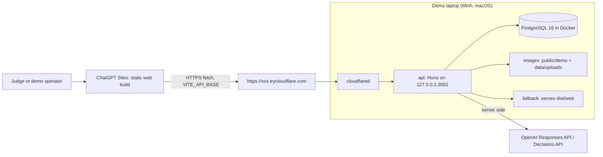

# seaPilot - Architecture

Decided 31 Oct 2026, 12:00 (Asia/Saigon). Supersedes every earlier topology note.

## Topology

| Part | Where | Responsibility |
|---|---|---|
| web | ChatGPT Sites (public) | Two screens `/customer` and `/cs`, demo bar. Static. Talks only to `VITE_API_BASE`. |
| api | Minh's Mac, port 3001 | Routes, Zod validation, CaseStore, agent loop, triage, approvals, CORS, files. |
| Postgres | Docker on the Mac, port 5432 | All demo data, Drizzle migrations. Reset = truncate + seed. Never exposed. |
| cloudflared | Minh's Mac | Quick tunnel, random hostname, no account. Restart = new URL. |
| OpenAI | cloud | Only outbound network call during the demo. |

## Why this shape
- The judged logic (link case, what changed, one question, approve-then-act) lives in
  `api/src/ai` and `api/src/store`. The storage engine is behind `CaseStore`; swap
  the adapter for Postgres later without touching logic.
- Postgres in Docker: the demo laptop already runs Docker, so one `docker compose up`
  gives a real schema with migrations and no local install. Storage stays behind
  `CaseStore`, so the demo could run on another adapter if Docker fails.
- Static FE on Sites: public, shareable link. The API serves `web/dist` too, so if
  Sites cannot reach the tunnel (CSP), the tunnel URL alone still shows the full app.

## Gates (time, Asia/Saigon)
- 13:30 Sites gate: a hello page on Sites must fetch `GET /api/health` through the
  tunnel from a phone. If it fails, demo link = tunnel URL only. No further debate.
- 14:30 Scene 2 runs end to end on Minh's Mac. WIP submission uses the tunnel URL.

## Request flow
1. Customer sends a message on `/customer` -> `POST /api/conversations/:id/messages`.
2. API runs triage (T07b, after Scene 2) -> `decideMode` -> human: `routeHuman`, set
   assignee, event `routed`; ai: run agent read-only, send reply, event `auto_reply`.
3. CS opens `/cs`, clicks Suggest -> `POST /api/agent/suggest` -> agent loop with
   tools `find_cases`, `get_case_context`, `get_order_shipments` -> `AgentSuggestion`.
4. CS approves -> `POST /api/cases/:id/approve` -> API writes message / task + events.
   UI shows "Sent" or "Escalated" only after `ok: true`.

## Env
- .env: `OPENAI_API_KEY`, `OPENAI_MODEL`, `DEMO_RESET_TOKEN`, `CORS_ORIGINS`, `DATABASE_URL`,
  `POSTGRES_PASSWORD`,
  later `TRIAGE_PROVIDER`, `DECISIONS_MODEL`.
- web/.env: `VITE_API_BASE`.

## CORS and files
Exact-origin allowlist, `Vary: Origin`, OPTIONS answered before auth, CORS headers on
error responses too. `GET /files/*` is public (demo images are not sensitive).
The web app stores file paths relative to the API, never the tunnel hostname.

## Operating the tunnel
- Start: `docker compose up -d db && pnpm db:migrate && pnpm db:reset && pnpm dev`, then
  `pnpm tunnel`. Copy the printed URL.
- New URL after restart: set `VITE_API_BASE`, rebuild web, republish Sites.
  `CORS_ORIGINS` changes only if the Sites origin changes.
- Limits: no uptime promise, no SSE. The agent endpoint returns a complete response.
- Keep the Mac awake, plugged in, notifications off. Phone hotspot as backup.
