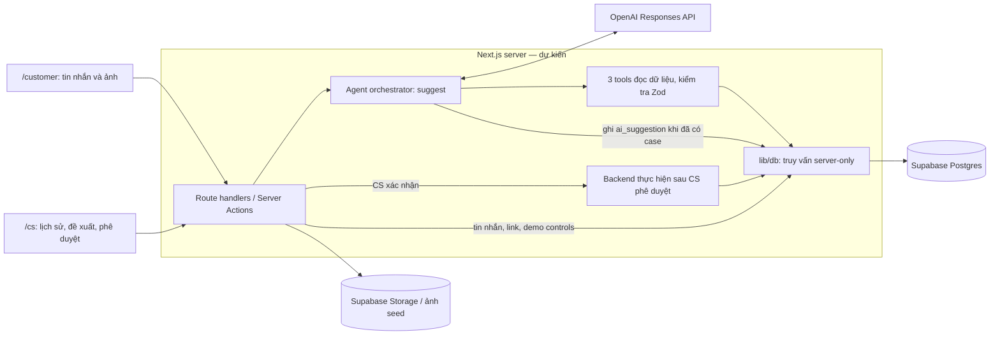

# seaPilot — Rà soát toàn bộ kế hoạch và kiến trúc

> **Bản rà soát lịch sử, trước thay đổi hosting.** Kiến trúc đã chốt và kế hoạch đưa API local ra public nằm trong [Architecture](Architecture.md). Nhận định về file/kiến trúc bên dưới là snapshot tại thời điểm ghi nhận.

Ngày rà soát: **31/10/2026, bắt đầu 10:15 (Asia/Saigon, UTC+07)** · Phạm vi: checkout `D:\project\SeaHackathon`, nhánh `main`, HEAD `3689ecb`. Kiểm kê ban đầu lúc 10:16; ghi nhận thay đổi song song lúc 10:21–10:22.

**seaPilot hiện có kiến trúc được mô tả bằng tài liệu, chưa có ứng dụng được triển khai trong checkout này.** Hướng thiết kế là một ứng dụng Next.js gồm hai màn hình, backend cùng dự án, Supabase lưu trạng thái case và một AI agent đề xuất nội dung. Điểm trung tâm là giữ liên tục một case qua nhiều cuộc hội thoại; CS phê duyệt trước khi gửi trả lời hoặc thực hiện hành động.

Thiết kế tổng thể phù hợp với ba demo, nhưng kế hoạch T01–T10 chưa nối kín đường chạy từ reset đến Demo 3. Ba chỗ cần chốt trước khi chia việc là **tạo case lần đầu**, **lưu mốc trạng thái shipment khi gửi câu trả lời**, và **luồng phê duyệt có lưu kết quả nhất quán**. Bàn giao người phụ trách và xử lý ảnh trước khi có case cũng chưa được phân công đủ rõ.

## 1. Phạm vi và cách đọc kết quả

- **Yêu cầu đã có:** được ghi trong [AGENTS.md](../AGENTS.md), [build prompts](../prompts/02-build-tasks.md), [runtime prompt](../prompts/03-runtime-prompt.md) hoặc [demo fixtures](../prompts/04-demo-data.md). Đây là quy định/kế hoạch, chưa phải bằng chứng code chạy được.
- **Bản nháp chuẩn bị:** toàn bộ [prep pack](prep-2026-10-31/README.md), gồm overview và các tab 01–07, còn ghi trạng thái chờ Hoàng xác nhận. Các bản dịch là snapshot; không tự động thay thế execution prompts trong `prompts/`.
- **Đề xuất reviewer:** cách lấp chỗ trống hoặc điều chỉnh thứ tự làm; chưa được coi là contract đã chốt. Báo cáo này không sửa các tài liệu nguồn.
- **Bằng chứng triển khai:** chỉ kết luận từ file và lệnh thực tế; không lấy write-up, pitch hoặc placeholder làm bằng chứng ứng dụng hoàn thành.

Đã đọc toàn bộ `docs/prep-2026-10-31/`, gồm cả [review trước](prep-2026-10-31/review.md). Tài liệu này tổng hợp lại kiến trúc và bổ sung ảnh hưởng của các thiếu sót lên thứ tự triển khai, thay vì coi các đề xuất cũ là quyết định đã được chấp thuận.

## 2. Trạng thái thực tế của repository

| Hạng mục | Quan sát tại thời điểm rà soát | Hệ quả |
| --- | --- | --- |
| Quy tắc, prompts, prep docs, Codex log | Có tài liệu và bộ skill hỗ trợ phát triển | Đủ đầu vào để thiết kế và bắt đầu T01 |
| `package.json`, `app/`, `lib/` | Chưa có | Chưa có scaffold, UI, API hoặc agent loop để kiểm tra |
| `supabase/`, `tests/` | Chưa có | Chưa có migration, seed hay continuity test |
| `public/`, `.env.example` | Chưa có | Ảnh demo và mẫu biến môi trường trong T01/T02 chưa được tạo |
| `.gitignore`, `scripts/codex-usage/*.mjs` | Xuất hiện dưới dạng file chưa được Git theo dõi lúc 10:21, trong khi rà soát | Thay đổi song song về công cụ ghi nhận sử dụng Codex; chưa phải scaffold ứng dụng seaPilot |
| Deployment và model thật | Chưa có bằng chứng chạy trong checkout | Không xác nhận Vercel hoặc real-model demo hoạt động |

Đã thử `pnpm typecheck`, `pnpm lint`, `pnpm test`: **cả ba exit 1 với `ERR_PNPM_NO_PKG_MANIFEST` vì không có `package.json`**. Đây là thiếu scaffold, không phải lỗi test logic và cũng không phải kết quả đạt. Chưa thể chạy `POST /api/demo/reset` hay kiểm chứng ba demo. Task rà soát này chỉ tạo báo cáo, thêm liên kết vào mục lục docs và cập nhật task log; các file công cụ xuất hiện song song không thuộc thay đổi của báo cáo.

## 3. Kiến trúc dự kiến

Theo [AGENTS.md](../AGENTS.md) và [T01–T09](prep-2026-10-31/02-build-tasks.md), có thể mô tả thiết kế là **một ứng dụng Next.js với các module tách theo trách nhiệm**, deploy cùng nhau trên Vercel. Không có yêu cầu microservice, vector database, hàng đợi hay nhiều AI agent trong phạm vi demo.

Sơ đồ là phân chia trách nhiệm theo plan; đường upload thực tế qua route nào và cách cấp quyền Storage **chưa được đặc tả**. Không có đường model gọi trực tiếp database. Ba function tools hiện được yêu cầu đều là thao tác đọc; backend orchestrator vẫn được yêu cầu ghi event `ai_suggestion`, nên không thể gọi toàn bộ module AI là chỉ đọc. Nguồn: [T03, T04, T06, T08](prep-2026-10-31/02-build-tasks.md).

| Tầng | Trách nhiệm đã mô tả | Task |
| --- | --- | --- |
| `app/customer/` | Tạo hội thoại mới, gửi text/ảnh, nhận câu trả lời đã được duyệt | T06 |
| `app/cs/` | Danh sách hội thoại, chat, case timeline, ảnh, AI suggestion, duyệt riêng reply/action | T05, T07–T09 |
| `app/api/` | Nhận request, kiểm tra dữ liệu, gọi nghiệp vụ, trả kết quả | T02–T04, T07–T08 |
| `lib/schemas/` | Zod là nguồn chung cho types và input/output | T02–T04; quy tắc chung |
| `lib/db/` | Supabase client và truy vấn chỉ chạy server | AGENTS.md, T02–T03 |
| `lib/ai/` | Load runtime prompt, tool definitions, Responses loop, parse/fallback | T03–T04, T07 |
| `supabase/` | Migration và seed xác định các trạng thái demo | T02 |
| `tests/` | Unit/contract checks và câu chuyện continuity | T02–T04, T07–T08, T10 |

### Ranh giới quyền và dữ liệu

Yêu cầu hiện có: secrets ở server; Zod kiểm tra API và tool; mọi fact hiển thị cho CS có nguồn `customer`, `system` hoặc `unverified`; CS duyệt từng reply/action; backend ghi approval và kết quả vào `case_events`. `delivered` chỉ là trạng thái do carrier báo, ảnh khách gửi không phải kết luận lỗi đóng hàng. Nguồn: [AGENTS.md, hard rules 1–8](../AGENTS.md), [runtime source/action rules](prep-2026-10-31/03-ai-runtime.md).

`Signed in as: CS A / CS B` chỉ là state trên UI, **không có authentication theo T05**. Nó thể hiện người thao tác trong demo, chưa xác thực danh tính. `?demo=1` chỉ bật/ẩn demo bar. T02 có token cho reset routes, T09 giữ token ở server, nhưng chưa định nghĩa ai được phép gọi server action chuyển tiếp token. **Đề xuất:** nếu demo public, kiểm tra quyền truy cập ở chính mutation/server action và các route liên quan; không coi việc ẩn token hoặc ẩn nút là kiểm soát quyền. Đây là phần cần chốt, không phải tính năng auth đã có.

## 4. Data model: đã nêu gì, còn thiếu gì

Case là đơn vị giữ ngữ cảnh lâu dài. Một case có thể có nhiều conversations và nhiều CS tham gia; một conversation mới được phép chưa liên kết case. Các bảng dưới đây là **minimum model trong [AGENTS.md](../AGENTS.md)**, chưa có DDL để xác minh khóa ngoại, nullability hay indexes.

| Bảng | Vai trò / trường đã nêu | Quan hệ hoặc contract cần làm rõ |
| --- | --- | --- |
| `customers` | Khách hàng; fixture `CUST001` | Liên kết tới order và conversation chưa được liệt kê thành schema |
| `orders` | Đơn hàng; mã `DH001` | Phân biệt mã hiển thị và ID nội bộ; lookup từ mã đơn |
| `order_items` | Hai mặt hàng T-shirt và cap | Mapping mỗi item tới shipment để trả `parcels[].items` |
| `shipments` | `parcel_code`, `status`, `updated_at` | Order FK; lịch sử/snapshot để so sánh trước và sau |
| `cases` | `code`, `status`, `assignee`, `order_id` | Fixture còn cần `title`; cách tạo `CS001`, customer association |
| `conversations` | `case_id` nullable, `channel`, `opened_at` | Customer association; T03 trả `summary` nhưng chưa có cách tạo/lưu |
| `messages` | `conversation_id`, `role`, `text`, `created_at` | Actor của CS, thứ tự ổn định, quan hệ ảnh/tin nhắn |
| `evidence` | `case_id`, `type`, `url`, `source`, `created_at` | Ảnh đến trước case; trace tới conversation/message; tránh trùng khi retry |
| `case_events` | `case_id`, `type`, `actor`, JSON `payload`, `created_at` | Schema payload theo event; approval, result, snapshot baseline |
| `tasks` | `case_id`, `team`, `status`, `evidence_ids`, `created_at` | Kiểm tra evidence thuộc case; transaction và idempotency khi approve |

Quan hệ logic mà câu chuyện đòi hỏi: customer → orders; order → items/shipments/cases; case → conversations/evidence/events/tasks; conversation → messages. Cách hiện thực khóa ngoại và kiểu ID vẫn là việc T02 phải quyết định; bảng trên không xác nhận các cột chưa được viết trong minimum model đã tồn tại.

Trạng thái case được nêu là `open → waiting_customer → waiting_ops → resolved`. Demo yêu cầu sau Demo 1 là `open`, cuối Demo 3 là `waiting_ops`; thời điểm đi qua `waiting_customer` chưa được gán cho endpoint nào. Runtime cấm đề xuất đóng case, nên `resolved` nằm trong model nhưng không thuộc hành động demo. Cần chốt transition thực tế thay vì mặc định mọi case phải đi qua toàn bộ chuỗi. Nguồn: [AGENTS.md](../AGENTS.md), [demo states](prep-2026-10-31/04-demo-data-and-runbook.md), [runtime action rules](prep-2026-10-31/03-ai-runtime.md).

**Đề xuất reviewer cho continuity:** khi reply được gửi thành công, lưu các shipment facts dùng để trả lời cùng mốc reply, rồi lấy reply CS gần nhất của **toàn case** làm baseline. T07 so sánh baseline này với shipment hiện tại ở backend; model chỉ diễn đạt danh sách thay đổi. Plan hiện yêu cầu phép so sánh nhưng chưa chọn snapshot hay status history. Nếu có status mới giữa lúc tạo đề xuất và duyệt reply, cần quy định dùng phiên bản facts nào và khi nào phải tạo lại đề xuất.

## 5. API và tool contracts

### Các endpoint được đặt tên trong plan

Tất cả dưới đây là **endpoint dự kiến**, chưa được implement. Bảng giữ đúng mức chi tiết nguồn, không suy đoán response schema còn thiếu. Nguồn chính: [T02–T04, T07–T09](prep-2026-10-31/02-build-tasks.md).

| Method / endpoint | Contract đã nêu | Thiếu cần chốt |
| --- | --- | --- |
| `POST /api/demo/reset` | Header `x-demo-token`; xóa dữ liệu và seed Start | Response/error; phạm vi xóa; reset đồng bộ với thao tác đang chạy |
| `POST /api/demo/advance-day` | Cùng token; B thành `delivered`, `updated_at = now`; event nếu có case | Retry/repeated click; baseline không bị thay thế |
| `POST /api/demo/jump?to=demo2` | Cùng token; seed After Demo 1 | B vẫn `in_transit`; cần Next day trước M2 |
| `GET /api/cases/:id/context` | Dùng lại `get_case_context` | Error, ID/code, thứ tự dữ liệu, snapshot changes |
| `GET /api/orders/:id/shipments` | Dùng lại `get_order_shipments` | Cách tìm order ID lần đầu khi chưa có case |
| `POST /api/agent/suggest` | Body `{ conversation_id }`; trả suggestion đã validate | Envelope lỗi/fallback; suggestion khi chưa có case được lưu ở đâu |
| `POST /api/cases/:id/link-conversation` | Body `{ conversation_id, actor }`; set case và event `conversation_linked` | Handover assignee, relink, pending evidence, idempotency |
| `POST /api/cases/:id/approve` | Body `{ kind: "reply" | "action", payload, actor }` | Zod discriminated payload; conversation/suggestion identity; transaction/retry |

Chưa có endpoint/contract rõ cho tạo case, tạo/list/read conversations, gửi customer message, upload/attach evidence, hoặc cập nhật dữ liệu giữa hai màn hình. T05/T06 đòi hỏi các khả năng đó nhưng không gán đầy đủ backend cho task nào. **Đề xuất:** bổ sung chúng vào phạm vi T02/T05/T06 sau khi thống nhất schema; tên route cụ thể chưa quyết định. Chọn polling/refetch đơn giản hoặc cơ chế khác và kiểm thử tin nhắn/ảnh xuất hiện ở màn hình CS; plan chưa bắt buộc Supabase Realtime.

### Ba tools và agent loop

| Tool đã nêu | Input | Output trọng tâm |
| --- | --- | --- |
| `find_cases` | `{ customer_id?, order_id?, text? }` | `{ case_id, code, status, last_activity_at, score, reason }[]` |
| `get_case_context` | `{ case_id }` | Case, conversations/summary, 20 messages gần nhất, evidence, 20 events gần nhất, open tasks; T07 thêm `changes_since_last_contact` |
| `get_order_shipments` | `{ order_id }` | Order và parcels gồm items, status, updated_at |

T04 dùng OpenAI Responses API; tối đa 6 tool calls, timeout toàn lượt 30 giây; model lấy từ `OPENAI_MODEL`, không gửi `temperature`/`top_p`. Kết quả phải parse bằng Zod; sai schema thì retry một lần, vẫn sai thì draft rỗng với error flag. Mỗi suggestion được ghi `ai_suggestion` nếu đã có case. Nguồn: [AGENTS.md](../AGENTS.md), [T03–T04](prep-2026-10-31/02-build-tasks.md).

`AgentSuggestion` đã có các trường: `suggested_case_id`, `link_confidence`, `link_reason`, `known_facts[{text,source}]`, `changes[{text,before,after}]`, `missing_info` tối đa một phần tử, `draft_reply`, `proposed_action` là null hoặc `escalate_to_ops` kèm reason và evidence IDs. Runtime thêm quy tắc tối đa bốn câu, theo ngôn ngữ khách hàng, không hứa hoàn tiền/đổi hàng/ngày giao. Nguồn: [T04](prep-2026-10-31/02-build-tasks.md), [runtime](prep-2026-10-31/03-ai-runtime.md).

Những contract AI chưa kín:

1. Runtime nói tìm theo order **code**, trong khi tool nhận `order_id`. Chưa có bước resolve mã đơn; M1 còn không chứa `DH001`, nên lần đầu cần lấy order từ customer/context ở backend.
2. Runtime yêu cầu đọc case rồi order trong case, nhưng Start chưa có case và model bị cấm tạo case. No-match/ambiguous-case cần nhánh riêng; không thể cứ tiếp tục gọi `get_case_context` với null.
3. Error flag của fallback không nằm trong shape `AgentSuggestion`. Cần success/error envelope hoặc union đã validate, đồng thời khóa approval khi dữ liệu không hợp lệ.
4. Schema chỉ mô tả hình dạng. Backend còn phải kiểm tra case/conversation/evidence cùng phạm vi; không thực thi `evidence_ids` tùy ý chỉ vì chúng là string.
5. `last 20` không tự bảo đảm nhớ mọi dữ kiện cũ. Demo ngắn vẫn có thể đủ, nhưng không nên khẳng định continuity cho lịch sử dài khi chưa có strategy summary/structured facts và test.

Nguồn cho các chỗ trống: đối chiếu [T03–T04, T07–T08](prep-2026-10-31/02-build-tasks.md), [runtime steps/output](prep-2026-10-31/03-ai-runtime.md) và [Start/M1](prep-2026-10-31/04-demo-data-and-runbook.md). Các hướng lấp chỗ trống ở trên là đề xuất reviewer.

## 6. Ba demo đi qua kiến trúc thế nào

### Demo 1 — tạo ký ức của case

Luồng mong muốn: Reset → customer gửi M1 + ảnh A → CS A lấy đề xuất → tạo/link `CS001` và gắn ảnh → CS A duyệt R1 → lưu message, event và baseline shipment. Kết quả là một case `open`, một conversation, một ảnh; B vẫn `in_transit`, chưa có task operations. Nguồn đích đến: [After Demo 1/R1](prep-2026-10-31/04-demo-data-and-runbook.md).

**Chưa nối kín:** nguồn không quy định chính xác case được tạo trước hay sau lượt suggest đầu, ai xác nhận, attachment được giữ ở đâu trong lúc chưa có case, và cách đọc order ở nhánh no-match. **Đề xuất:** CS xác nhận tạo case qua backend, gắn conversation/evidence trong cùng nghiệp vụ; tools model tiếp tục chỉ đọc. Phần reply approval tối thiểu phải có ngay trong đường chạy Demo 1.

### Demo 2 — tiếp tục case qua cuộc hội thoại mới

Luồng đã yêu cầu: Next day cập nhật B `in_transit → delivered` → mở CONV2 và gửi M2 → CS B lấy suggestion → xác nhận link CONV2 vào CS001 → xem lịch sử, ảnh cũ và thay đổi → duyệt R2 hỏi đúng một điều: chưa nhận B hay đã nhận B nhưng thiếu cap. Không đề xuất escalation lúc chưa biết câu trả lời. Nguồn: [T07](prep-2026-10-31/02-build-tasks.md), [runtime Example A](prep-2026-10-31/03-ai-runtime.md), [M2/R2](prep-2026-10-31/04-demo-data-and-runbook.md).

**Chưa nối kín:** không có baseline reply-time; endpoint link chưa cập nhật `assignee`; case ID bị lẫn với code `CS001`. Link được phê duyệt cần giữ lại cả hai conversations và ảnh cũ, không tạo case thứ hai. Handover sang CS_B là yêu cầu của final fixture nhưng chưa có mutation được gán thực hiện.

### Demo 3 — phê duyệt rồi mới xác nhận thành công

Luồng đã yêu cầu: M3 + ảnh B vào CONV2 → giữ EV1 và thêm EV2 → AI đề xuất `escalate_to_ops` với hai ảnh → CS B duyệt action → backend tạo task, chuyển `waiting_ops`, ghi kết quả → chỉ sau thành công mới duyệt gửi R3 xác nhận đã chuyển operations. Nguồn: [T08](prep-2026-10-31/02-build-tasks.md), [runtime Example B](prep-2026-10-31/03-ai-runtime.md), [Demo 3 runbook](prep-2026-10-31/04-demo-data-and-runbook.md).

**Chưa nối kín:** runtime cấm nói hành động đã xong trong draft, còn R3 là câu trả lời sau thành công. Cần hai trạng thái rõ: draft trước action và reply sau `action_executed`; action approval và reply approval vẫn tách riêng. **Đề xuất:** khi thành công thì tạo lại/chỉnh draft từ result đã lưu và duyệt gửi; khi thất bại, giữ UI lỗi và không tạo thông báo hoàn tất. Gom task/status/result thành transaction, dùng khóa idempotency cho retry; ghi approval lẫn outcome có liên kết, thay vì chỉ một event kết quả mơ hồ.

Final fixture yêu cầu **1 case, 2 conversations, 2 evidence nguồn customer, 1 task open, case waiting_ops, assignee CS_B**. T10 hiện chưa assert rõ assignee, đúng hai evidence IDs trên task hoặc reply sau action; nên bổ sung các assertion này cùng failure/retry path. Nguồn: [final state](prep-2026-10-31/04-demo-data-and-runbook.md), [T10](prep-2026-10-31/02-build-tasks.md).

## 7. Mapping T01–T10 và vấn đề phụ thuộc

Owner/thời gian sau đây là **lịch trong bản prep**, không phải tiến độ thực tế. Dependency và nhận xét là tổng hợp reviewer. Nguồn: [assignments, timeboxes và tasks](prep-2026-10-31/02-build-tasks.md).

| Task | Owner / giờ dự kiến | Đầu ra và phụ thuộc | Nhận xét |
| --- | --- | --- | --- |
| T01 | Phong, 10:00–10:45 | Scaffold, scripts, env example, pages; sau đó human deploy | Chưa có scaffold trong checkout |
| T02 | Phong, 10:45–11:45 | DB, schemas, seed, demo routes | Cần chốt ID, ảnh pending, baseline trước migration |
| T03 | Hoàng, 10:45–11:45 | Tools/API đọc; dùng schema và seed T02 | Chạy cùng T02 chỉ khả thi sau khi contract chung thống nhất |
| T04 | Hoàng, 11:45–12:30 | Agent loop + suggestion API; dùng T03/runtime | Có real-call gate, nhưng chưa đủ toàn bộ Demo 1 |
| T05 | Minh, 10:45–12:30 | CS UI; từ mock chuyển sang API | List/chat API và approval backend phải có để demo hoàn chỉnh |
| T06 | Minh, 13:00–13:45 | Customer text, new conversation, upload | Đang sau milestone Demo 1 12:30 dù Demo 1 dùng màn hình này |
| T07 | Hoàng, 13:00–14:15 | Link, change detection, Demo 2 test | Phụ thuộc baseline T02 và reply persistence T08 |
| T08 | Phong, 14:00–15:00 | Approve reply và escalation | Reply approval là dependency của Demo 1; phải tách phần tối thiểu làm sớm |
| T09 | Phong, 14:30–15:00 | Demo bar, gọi demo routes qua server action | Chồng cùng owner T08; rehearsal cần T06–T08 hoàn chỉnh |
| T10 | Như, 15:00–16:00 | Full continuity test và README | Kéo qua feature freeze 15:30; nên viết test khung từ đầu |

Milestone **Demo 1 chạy model thật lúc 12:30 hiện không khớp dependency**: màn hình khách và approve reply mới được lên lịch sau đó, chưa kể tạo case chưa thuộc task nào. Có thể giữ giờ chỉ khi kéo tối thiểu nhập tin/ảnh seed, tạo case và duyệt reply vào trước milestone; nếu chưa điều chỉnh, một real call T04 thành công không chứng minh Demo 1 chạy xuyên suốt.

## 8. Các điểm cần xử lý theo ưu tiên

`P0`: ngăn đường chạy demo đúng yêu cầu. `P1`: ảnh hưởng correctness, tích hợp hoặc khả năng demo lặp lại. `P2`: hoàn thiện tài liệu, đo đạc và giới hạn phát biểu. Đây là mức ưu tiên reviewer, không phải thứ tự đã được chủ dự án duyệt.

| Ưu tiên | Khoảng trống / mâu thuẫn | Hướng xử lý đề xuất | Task / nguồn |
| --- | --- | --- | --- |
| P0 | Start không có case; model cấm tạo case; chưa có create-case flow | Backend tạo case với xác nhận CS, link conversation và attach evidence; định nghĩa nhánh order-only | T02–T06; [review](prep-2026-10-31/review.md) |
| P0 | T07 cần trạng thái ở lần trả lời trước nhưng chỉ lưu shipment hiện tại | Snapshot khi reply thành công hoặc history đầy đủ; backend tính diff | T02, T07, T08 |
| P0 | Demo 1 12:30 đi trước T06 và T08 | Kéo text/seed attachment + reply approval tối thiểu làm sớm | [lịch T01–T10](prep-2026-10-31/02-build-tasks.md) |
| P0 | T08 chưa quy định atomicity, retry và bản ghi approval tách với result | Một nghiệp vụ transaction cho task/status/result; idempotency; failure không trả success | T08, T10; AGENTS rule 5 |
| P1 | Thiếu conversation/message/evidence API, ảnh tới trước case | Chốt ownership và Zod contracts; attachment pending, attach không copy trùng | T02, T05, T06 |
| P1 | Final assignee CS_B nhưng switcher chỉ UI, link chỉ set case_id | Persist handover được CS xác nhận, event actor rõ ràng | T05, T07, T10 |
| P1 | ID/code và order_id/order code không thống nhất | Chốt ID strategy; test dùng ID, UI hiện code; resolve order ở backend | T02–T04, T07 |
| P1 | Error flag ngoài schema; no-match/tool failure chưa đủ nhánh | Envelope/union có validate; không cho approve fallback lỗi | T03–T05 |
| P1 | R3 khẳng định đã escalation, draft trước action chưa thể biết kết quả | Draft theo trạng thái; phê duyệt reply sau result thành công | T04, T08; Demo 3 |
| P1 | Secret token ở server nhưng server action chưa có access gate | Kiểm tra quyền tại entry point mutation; xác định giới hạn public demo | T02, T05, T09 |
| P1 | Reset hai lần đòi hàng giống hệt, timestamps lại tính theo thời gian reset | Inject/freeze clock trong test hoặc định nghĩa equality theo business fields | T02; fixture |
| P1 | Jump Demo 2 vẫn B in_transit; shortcut runbook thiếu Next day | Thêm Next day khi diễn shortcut hoặc chốt lại semantics jump | T02, T09; runbook |
| P1 | `Warehouse Ops` khác `operations`; R1 chưa có timestamp hợp chronology | Dùng internal identifier và label tách; đặt R1 sau thời điểm A delivered | T02, T08, T10; fixture |
| P1 | Cắt tạo task thật T08 trái assertion T10 và final fixture | Nếu cắt, đổi acceptance thành simulated và công khai giới hạn | Scope cuts, T08, T10 |
| P2 | `last 20`, summary, sentence/question rules chưa đủ test semantic | Giữ chứng cứ cần thiết; test không hỏi lại, không hứa, không gọi action sai điều kiện | T03–T04, T10 |
| P2 | Target dưới 15 giây khác timeout 30 giây; pitch nói chi phí/scale chưa đo | Phân biệt target với timeout; đo real-model latency, không suy rộng | Runtime, runbook, pitch |
| P2 | Write-up/declarations có câu như đã build và số liệu placeholder | Chỉ điền từ bằng chứng runtime/git/log; xác nhận nguồn ảnh/tooling và lịch chuẩn bị | [05](prep-2026-10-31/05-write-up-draft.md), [06](prep-2026-10-31/06-declarations-draft.md), [07](prep-2026-10-31/07-pitch-and-qa.md) |

## 9. Điều gì đã được quy định, điều gì còn mở

**Đã được quy định trong execution plan:** stack Next.js/TypeScript/Tailwind/shadcn/Supabase/OpenAI/Zod/Vitest; hai màn hình; một case xuyên hội thoại; ba tools đọc; human approval; nguồn của facts; action duy nhất `escalate_to_ops`; reset và jump; case cuối `waiting_ops`; secrets server-only; không thêm dependency khi chưa hỏi. Đây là cơ sở thiết kế có thể dùng ngay, không có nghĩa toàn bộ prep draft đã được Hoàng xác nhận. Nguồn: [AGENTS.md](../AGENTS.md), [prep README](prep-2026-10-31/README.md).

**Cần quyết định để code:** tạo case và lấy order lần đầu; chuẩn ID/code; schema quan hệ và attachment trước case; baseline và thời điểm cập nhật; trạng thái waiting_customer; persist assignee; error envelope; approval payload/transaction/idempotency; phân quyền mutation khi public; cơ chế đồng bộ hai màn hình. Không có file migration hay API schema để suy ra các quyết định này đã được chốt.

**Cần xác nhận từ owner cho demo/tài liệu:** model cấu hình; ngôn ngữ UI/vòng thi; hai ảnh thật và xuất xứ; lịch điều chỉnh; scope fallback; nội dung declarations. Overview, write-up, declarations và pitch đều còn là bản chuẩn bị. Các phát biểu lịch sự kiện, thời gian tạo repo, đã build on-site, số task/test/commit hoặc hiệu quả kinh doanh phải được đối chiếu riêng; báo cáo kiến trúc này không xác nhận chúng. Nguồn: [overview](prep-2026-10-31/00-prep-overview.md), [04](prep-2026-10-31/04-demo-data-and-runbook.md), [05–07](prep-2026-10-31/README.md), [review declarations](prep-2026-10-31/review.md).

## 10. Thứ tự triển khai đề xuất

1. **Chốt contracts trước khi chia task song song.** Viết ngắn gọn ID strategy, tạo case, pending evidence, reply baseline, handover và approval/error contracts. Không cần mở rộng nghiệp vụ ngoài ba demo; có thể đặt schema dùng chung trong phạm vi T02.
2. **T01 + nền T02:** scaffold, env/gitignore, database, seed cố định theo test clock, reset, schemas. Dựng khung continuity test từ các trạng thái kỳ vọng; chưa cần model thật để kiểm tra dữ liệu.
3. **Hoàn chỉnh đường Demo 1:** công cụ T03, agent T04, CS UI tối thiểu T05, text/ảnh seed của T06, tạo case, phần approve reply của T08. Chốt gate bằng reset → M1 → CS xác nhận → reply thực sự lưu và hiển thị; thêm một lượt gọi model thật.
4. **Hoàn chỉnh Demo 2:** T07 dùng baseline đã lưu, advance-day, tạo conversation mới, link/handover, giữ ảnh cũ, duyệt R2. Test case không nhân đôi và chỉ hỏi thông tin còn thiếu.
5. **Hoàn chỉnh Demo 3:** upload thật nếu còn thời gian, action approval, transaction/idempotency, task gắn EV1+EV2, failure path và reply sau thành công.
6. **T09 + T10 tích hợp:** reset/jump an toàn, chạy full story ba lần, hoàn thiện continuity assertions, typecheck/lint/test, đo real-call latency, kiểm tra live deployment. Sau đó mới điền README/write-up/declarations theo kết quả quan sát.

Có thể làm UI với typed mocks song song backend **sau khi thống nhất schemas và ownership file**. Không nên để nhiệm vụ thay đổi dữ liệu nền T02 chạy độc lập với việc thiết kế snapshot/approval rồi mới ghép ở cuối. Kế hoạch hiện không cần thêm hạ tầng hoặc dependency để lấp các khoảng trống nghiệp vụ này.

## 11. Điều kiện để tuyên bố kiến trúc đã được hiện thực

- Reset tạo đúng Start; jump + advance-day cho baseline Demo 2 đúng; dữ liệu không bị nhân đôi qua các lần chạy.
- Demo 1–3 chạy xuyên suốt với đúng final state, ảnh cũ được giữ, assignee bàn giao đúng và không hỏi lại dữ kiện đã lưu.
- Tool/model failure không gửi reply hoặc tạo action ngoài ý muốn; approve retry không tạo nhiều task/message; UI chỉ báo hoàn tất sau kết quả thành công.
- Có test mocked model kiểm tra nghiệp vụ và ít nhất real-model smoke check phù hợp T04; không gọi mock continuity test là bằng chứng độ chính xác của model thật.
- `pnpm typecheck`, `pnpm lint`, `pnpm test` đạt; reset hoạt động; không có secret trong diff; [Codex log](codex-log.md) ghi đúng việc đã làm và kết quả kiểm chứng.

Các mục trên là tiêu chí nghiệm thu từ [AGENTS.md](../AGENTS.md), [T02–T10](prep-2026-10-31/02-build-tasks.md), [demo final state](prep-2026-10-31/04-demo-data-and-runbook.md) cùng đề xuất bổ sung cho failure/retry. Tại lần rà soát này, chưa có code ứng dụng để xác nhận đạt các tiêu chí đó.
